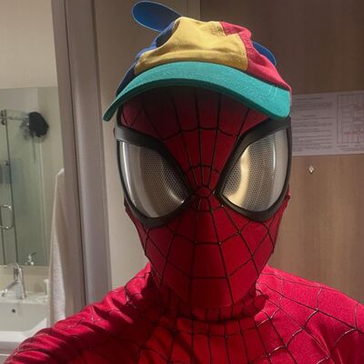

<!--
  INSTRUCCIONES:
  1. Repositorio PÚBLICO llamado Kevin66RGX (mismo nombre que tu usuario).
  2. Pega este contenido en el README.md.
  3. Sube tu foto como "foto.png" a la raíz del repo (relación 1:1, ej. 400x400 px).
-->

<table>
  <tr>
    <td>
      
    </td>
    <td>
      <h2>Kevin David Rojas</h2>
      <a href="https://github.com/Kevin66RGX">@Kevin66RGX</a> 
      💻 Computer Engineering Student 
      
      
      Barrancabermeja, Colombia · 2nd Semester
    </td>
  </tr>
</table>

---

## 🧑‍💻 About me

Hi! I'm a second-semester Computer Engineering student from Colombia interested in software development, artificial intelligence, cybersecurity, and electronics.

I enjoy learning independently, experimenting with ideas, and building projects to understand how things work under the hood.

---

## 🛠️ Tech & Interests

<table>
  <tr>
    <td width="70" align="center">
      
    </td>
    <td>
      <b>Programming</b> 
      
      
      
      
    </td>
  </tr>
  <tr>
    <td width="70" align="center">
      
    </td>
    <td>
      <b>Electronics</b> 
      
      
    </td>
  </tr>
  <tr>
    <td width="70" align="center">
      
    </td>
    <td>
      <b>Artificial Intelligence & Cybersecurity</b> 
      
      
    </td>
  </tr>
</table>

---

## 🕷️ Beyond the Code

- 🥊 Boxing and athletic training.
- 🧠 Science, philosophy, and critical thinking.
- 🎮 Geek culture, comics, superheroes, and science fiction.
- 🕸️ Spider-Man fan — science, creativity, and responsibility.
- ⚡ Experimenting with technology and learning through personal projects.

---

## 🌱 Currently Learning

- Strengthening my Java and programming fundamentals.
- Improving my Git workflow.
- Exploring Arduino and ESP32 projects.
- Building personal projects and expanding my technical skills.

---

  <b>🚀 Always curious. Always building. Always learning.</b>

